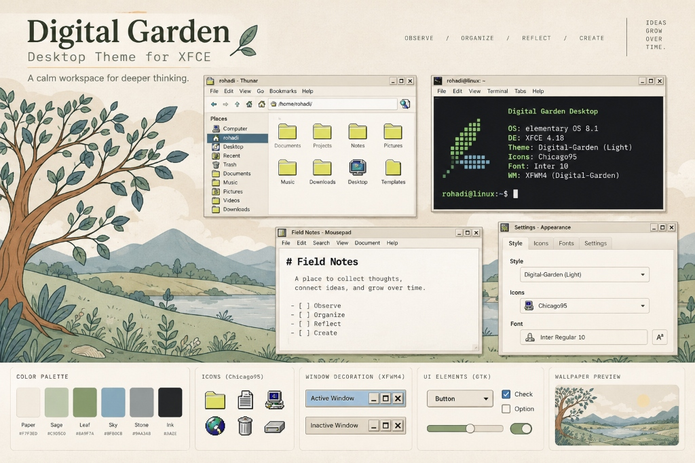

# Digital Garden Desktop

> A warm, paper-inspired, modernized retro workstation theme for XFCE 4.18 and GTK 3/4 on Linux.



---

## Overview

**Digital Garden — Retro Workstation** blends the tactile familiarity of classic retro workstations with modern paper surfaces, restrained steel-blue and sage-green accents, and contemporary typography (**Inter**).

Key characteristics:
- **Preserved Retro Identity**: Retains the installed **Chicago95** icon pack and cursors without modification.
- **Warm Paper Aesthetics**: Gentle cream surfaces (`#FCF9F4`, `#F7F3ED`) engineered for calm, long-form work and focus.
- **Custom XFWM4 Window Frame**: Clean steel-blue active title bar with tactile control buttons, 2px crisp borders, and soft red close prelight.
- **Native GTK 3.24 & GTK 4 Support**: Pixel-perfect, validated CSS without fragile hacks or breakage of Libadwaita portals.
- **Safe, Idempotent & Fully Reversible**: Timestamped automated backups and one-command rollback.

---

## Color Tokens

The authoritative palette is defined in [`tokens/colors.json`](tokens/colors.json):

| Token | Value | Purpose |
|---|---|---|
| `garden-bg` | `#F7F3ED` | Canvas & app background |
| `garden-surface` | `#FCF9F4` | Windows, cards, inputs |
| `garden-text` | `#2A2820` | Main text (15.2:1 contrast) |
| `garden-muted` | `#5D5242` | Subdued text & inactive titles |
| `garden-accent` | `#4A6B7B` | Steel-blue accent & active title bar |
| `garden-success` | `#5B7F6A` | Sage-green success & indicators |
| `garden-border` | `#C8BEAF` | Borders & separators |
| `garden-warning` | `#B88942` | Amber warnings |
| `garden-insight` | `#76648B` | Ideas & knowledge tag accent |

---

## Primary Usage & Commands

The project provides a single unified installer [`install.sh`](install.sh) and a clean restoration script [`rollback.sh`](rollback.sh) at the root level:

```bash
cd ~/Projects/xfce-themes-note

# 1. Inspect environment and check asset readiness without changing the desktop (non-mutating)
bash ./install.sh --check

# 2. Preview intended installation changes without modifying anything (dry-run mode)
bash ./install.sh --dry-run

# 3. Apply Digital Garden theme, wallpaper, and typography safely (creates automated backup)
bash ./install.sh

# 4. Restore the previous desktop configuration at any time
bash ./rollback.sh
```

### Advanced Rollback Options

```bash
# List all available timestamped backups
bash ./rollback.sh --list

# Restore a specific timestamped backup
bash ./rollback.sh 20261009_082106

# Run security & secret scanning check
bash ./scripts/security-check.sh --all
```

---

## Project Structure

```text
xfce-themes-note/
├── .gitignore                                 # Strict privacy & secret exclusion rules
├── install.sh                                 # Primary installer (--check, --dry-run, live install)
├── rollback.sh                                # Primary rollback utility
├── README.md                                  # Documentation and quickstart
├── index.theme                                # Theme metadata
├── docs/
│   ├── DESIGN-SYSTEM.md                       # Design system specifications & contrast
│   ├── INSTALLATION.md                        # Detailed installation workflow
│   ├── ROLLBACK.md                            # Rollback safety documentation
│   ├── COMPATIBILITY.md                       # Compatibility matrix & boundaries
│   └── SECURITY-GUIDELINES.md                 # Security & screenshot privacy rules
├── tokens/
│   └── colors.json                            # Canonical color tokens
├── gtk/
│   ├── gtk-3.0/
│   │   ├── gtk.css                            # GTK 3.24 Stylesheet
│   │   └── gtk-dark.css                       # GTK 3 Dark Variant
│   └── gtk-4.0/
│       ├── gtk.css                            # GTK 4 / Libadwaita Stylesheet
│       └── gtk-dark.css                       # GTK 4 Dark Variant
├── xfwm4/
│   └── Digital-Garden/
│       ├── themerc                            # XFWM4 window geometry & colors
│       └── [PNG decoration assets]            # 52 tactile frame assets
├── assets/
│   ├── wallpaper/
│   │   └── digital-garden-1920x1080.jpg       # High-definition retro garden wallpaper
│   └── previews/
│       ├── preview.jpg                        # Visual preview showcase
│       └── palette-preview.svg                # Vector palette preview
├── scripts/
│   ├── generate_assets.py                     # Asset generator for XFWM4 and SVG
│   ├── install.sh                             # Internal asset copy utility
│   ├── apply.sh                               # Internal application utility
│   ├── verify.sh                              # Live environment verification check
│   ├── security-check.sh                      # Pre-commit secret & privacy scanner
│   └── rollback.sh                            # Internal rollback utility
└── tests/
    └── static-checks.sh                       # Static syntax, integrity & security suite
```

---

## Safety Guarantees

1. **Strictly Non-Destructive**: Never uses `sudo` for home directory themes. Never alters system-wide files, bootloader, display manager, or `/etc/os-release`.
2. **Preserves Chicago95**: Preserves Chicago95 icons and cursor theme intact.
3. **Preserves Panel Configuration**: Keeps all existing launchers, Whisker Menu items, applets, and system tray untouched.
4. **Automated Timestamped Backups**: Every live installation automatically saves previous Xfconf settings and config files into `~/.local/share/digital-garden-backups/<timestamp>/manifest.json`.
5. **No Session Restarts**: Does not reboot, log out, or kill running desktop sessions.
